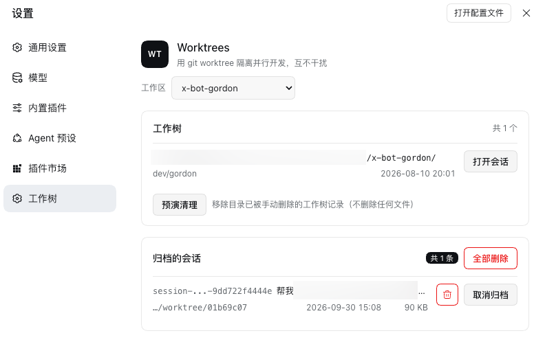

# gord-dsh-worktree

为 [DeepSeek Harness](https://github.com/deepseek-ai/deepseek-harness) 提供 Git worktree 管理：把并行开发
放进各自独立的目录与分支。随包附带 **快速模式**（Fast mode，agent 预设）、可选的并发补丁，
以及方便关注并行会话的轻量 **任务关注悬浮框**。

[English](README.md) · [详细说明](docs/internals.zh.md)

## 功能

1. **创建工作树** —— 一条原子命令同时建好隔离检出与分支；Agent（`worktree_list`、`worktree_create`、
   `worktree_status`、`worktree_remove`、`worktree_prune`、`worktree_relocate`）和
   *设置 → 工作树* 都能发起。
2. **在新工作树里开会话** —— New Session 那行有「工作位置」选择器：留在当前工作树，或新建一个把会话开进去。
3. **看改动** —— 右侧栏 *Changes* 页签列出当前会话目录的未提交改动：每个文件与增删行数，以及所选文件的 patch。
4. **管理归档会话** —— *设置 → 工作树* 列出本机归档的全部会话，每行有 **取消归档** 和删除图标，另有
   **全部删除**。
5. **双击重命名** —— 在侧栏的会话行上直接改名，不用打开菜单。
6. **快速模式** —— 一个精简的 agent 预设，随 bundle 补丁一起声明，装好插件后预设选择器里就有它。合并独立
   调用，保留必要澄清、有界等待和缺陷回归测试；收齐后台结果后才报告完成。按上下文理解明显的输入错误，但不替换
   点名的路径或资源。首次编辑前读取文件，原生编辑成功后复用已知版本，外部改动后再读；对自有端点的授权边界评测
   按工程执行，同时保留内容与拒绝边界。
7. **只读工具并发** —— 可选补丁，让 `bash`、`glob`、`grep` 的批量只读调用重叠执行，而不是一条接一条。
8. **会话悬浮卡片** —— 鼠标停在会话上时，最上面一行是它所在的工作区标题（主工作区如 `checkout-service`，工作树
   如 `checkout-service · ed466e1a`），下面一行是该目录所在的分支。
9. **任务关注悬浮框** —— 默认位于会话右侧索引下方，悬浮展开运行中、待处理和已结束未查看的会话；点击跳转成功后
   移除本轮提醒。按钮主数字是任务总数，角标是待处理与未查看数量。支持拖动记忆与位置恢复，移出后 200ms 收起。
   复用状态订阅，不轮询或加载聊天正文；需要宿主提供
   `uiSession.sessionStatus`（已核对 `0.2.0-rc.2`），缺少该能力时不显示。




## 任务关注悬浮框 · 0.6.0 新增

不用逐个打开会话，也能查看并行任务的状态。蓝色按钮默认位于会话右侧索引下方，鼠标移入展开，移出后收起；
没有需要展示的任务时自动隐藏。

| 显示内容 | 含义 |
| -------- | ---- |
| 按钮主数字 | 当前悬浮框中包含的会话总数 |
| 右上角角标 | 待处理会话与已结束未查看会话的数量之和 |
| 待处理 | 会话正在等待输入或审批 |
| 已结束未查看 | 本轮运行已停止、尚未查看；不代表任务一定成功 |
| 运行中 | 后台会话正在工作 |

点击列表项会打开**已有会话**，确认跳转成功后才移除本轮提醒；从侧栏打开会话也会确认已查看。
后续结束、新一轮运行或新的待处理请求仍可再次出现。拖动按钮可在本机记住位置，点击 **↺** 恢复到索引下方。
屏幕空间不足时会移动到索引旁，并避开消息输入框。

悬浮框复用宿主状态订阅，不轮询、不加载聊天正文，也没有持续动画；收起时不渲染详情，展开时每页最多 20 条。
这些设计用于减少后台开销，尚未进行内存占用的定量对比。提醒取自当前窗口的宿主状态，不提供跨窗口同步或重启后
恢复的独立通知收件箱。需要 `uiSession.sessionStatus`（已核对 `0.2.0-rc.2`）；旧宿主没有该能力时，
其他插件功能照常使用。

以下为**真实插件组件配合模拟会话数据**的界面演示，并非实际 DSH 会话截图。分别展示收起入口与展开详情。


## 工作树建在哪里

默认创建独立的 `worktree/<code>` 分支，从当前 `HEAD` 开始；游离 HEAD 也支持。已被其它工作树检出的分支
会被拒绝。旧版本已创建的共享分支工作树保留原样，继续并行开发前应各自切换到独立分支。删除安全检查包含
被 Git 忽略的文件（例如 `.env`），需要明确勾选丢弃后才能删除。

工作树建在**自己项目内部**：`<项目>/.dsh/worktrees/<code>`。目录真的在项目里，侧栏才能把它折进该项目；
同时它不会给项目的 `git status` 与 diff 添乱——插件把 `/.dsh/worktrees/` 写进了该仓库自己的
`.git/info/exclude`。想放到别处，可以在插件配置里设 `defaultParent`。

早期版本建在共享 `$DSH_HOME/worktree/` 的工作树仍然可用：*设置 → 工作树* 的 **搬进项目**（或 Agent 的
`worktree_relocate`）会把它们搬进项目，并在旧路径留一个符号链接，指过去的编辑器与终端照旧能打开。

## 侧栏嵌套

两个宿主都会把工作树折进它所属的项目。`dsh web` 靠的是插件打进浏览器 bundle 的补丁，加载时会自动确保它
已应用（也可以手动 `npm run patch:sidebar`）。桌面 App 则用它原生的 **按工作区树** 分组，只要客户端的视图
设置里有这一档，*设置 → 工作树* 就提供对应开关。桌面打不了补丁——它的界面在签名过的 app 包里——所以桌面靠
这个开关，而不是补丁。

树还会给工作树本身画一行文件夹，打过补丁的 web 侧栏则不会。对应的勾选项 **隐藏工作树行（会话照旧显示）**
默认开启，只去掉这些行：它们的会话上移一级、与项目自己的会话缩进对齐；没有活跃会话的工作树保留自己的行，
因为那行是它的 `+`（在这个工作树里开会话）和 `…`（改名/删除）唯一的入口。这是纯显示层——工作区本身不变，
取消勾选即可全部恢复。

## 安装

```sh
dsh plugin --profile web add gord-dsh-worktree@0.6.0
```

也可以从 GitHub 安装：

```sh
dsh plugin --profile web add github:nightosong/gord-dsh-worktree
```

然后重启 `dsh web`（bundle 进入层栈后，重新加载页面也够），打开 *设置 → 工作树*。不需要改任何文件：包里
声明了 `dsh.bundle.patch`，CLI 会自己把它加进 profile 的 bundle 层栈。

快速模式随之而来——同一个补丁声明了 `fast` 预设，预设选择器里直接出现 **快速模式**，不用改 profile。如果
profile 自己的 `cordis.patch.yml` 里已经手写过 `preset-fast` 行，请删掉它：bundle 层先合并，两行同 id 会把
预设挂载两次，而加载器不会报错。新会话**默认**用哪个预设仍然由用户决定（profile 补丁里的
`agent-preset-registry`），bundle 从不设置它。这个分工的另一面：快速模式是这个 bundle 声明的，卸载插件时
记得一并改掉或删掉那行 `default: fast`，否则它会指向一个已不存在的预设。

并发补丁是唯一需要手动执行的一步，因为它改的是核心工具包而不是插件自己的组合层：

```sh
cd /path/to/gord-dsh-worktree
npm run patch:concurrency     # 先 --check 看状态，--revert 还原
```

它需要重启 `dsh web`，可重复执行，而且**故意保持手动**：它改的是 `dsh-tool-bash` 与
`dsh-tool-fs-search`，而桌面端的签名包永远装不了这两个补丁——不自动打它，两个宿主对只读调用的调度才是
一致的。DSH 升级会覆盖这些文件，升级后重跑一次即可，用 `npm run check:concurrency` 看状态：`patched`、
`original`、分类器需更新时的 `outdated`，或构建已变时的 `unknown`——那时工具会拒绝强改，只报告。
已启用过并发补丁的安装也需要重跑一次，以更新分类器。

通过远程域名或反向代理访问时，在插件配置中设置完整来源白名单
`allowedOrigins: ["https://dsh.example.com"]`。直接通过 IP 访问时校验请求实际主机和端口。

## 跨版本兼容

版本范围覆盖从 `0.1.5-rc.1` 起的 0.1.x 与 0.2.x 正式版，并显式接受 `0.1.6`、`0.1.7` 和 `0.2.0`
的预发布版，包括桌面端 `0.2.0-rc.2`；其他版本的预发布版与 0.3.x 未纳入范围。此前经过测试的旧版包括
`0.1.5-rc.1`、`0.1.6-alpha.2`、`0.1.7-rc.2`；放宽声明不等于后续每个版本都经过完整实测。
图标导出名、会话跳转与插件设置接口在旧版区间里都变过，插件对每种形态都有处理：

| 接口 | 0.1.5 / 0.1.6 | 0.1.7 起 | 插件的做法 |
| ---- | ------------- | -------- | ---------- |
| 图标导出名 | `IconTrashOutline16` 等，按尺寸命名 | `IconTrashOutlineRegular` 等，按字重命名 | 两个名字都试，都不存在就不画，绝不把 `undefined` 交给 React |
| 会话跳转 | `sessions.open(id)` | `uiWorkspace.openSession(id)`，`sessions.open` 已移除 | 优先走工作区视图，没有时回退到旧调用 |
| 插件设置命名空间 | `settings.register(ns, schema)` | 无此方法，改由 profile 自己的表单模型接管 | 只在方法存在时注册命名空间，否则直接读该条目的配置 |

`uiWorkspace` 与 `settings` 都用 `ctx.get` 可选读取：profile 里没有工作区视图或没有设置时，只少一个功能，
而不是整个插件挂不上。

0.3.0 新增的两个功能要求高于上述下限，所以下限是**按功能**而不是按包的：**快速模式**需要 `0.1.7`
（预设是 `@deepseek-ai/dsh-agent-preset` 的组合行，0.1.7 才用它替换 `$DSH_HOME/.agent-presets` 的发现
方式）；**并发补丁**也需要 `0.1.7`，因为它精确匹配那三个核心文件。

## 详细说明

设计写在 [docs/internals.zh.md](docs/internals.zh.md)：工作树生命周期、补丁契约、归档及其存储、全部配置项
—— [English](docs/internals.md)。

## 许可证

MIT
